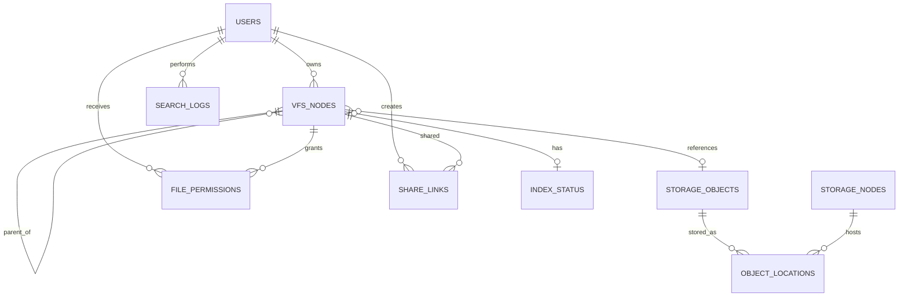

# CloudDisk 项目需求规格

> 本文档是 CloudDisk 当前阶段的项目需求单一事实源。  
> 当前阶段只负责源代码交付，不生成报告、视频或答辩材料。  
> 如果与早期 C++、Docker 或其他历史方案冲突，以本文档为准。

---

## 1. 项目概述

### 1.1 项目名称

**CloudDisk**

### 1.2 项目定位

CloudDisk 是一个面向个人和小团队的云盘文档管理系统。

用户可以：

- 创建文件夹
- 上传文件
- 下载文件
- 浏览文件树
- 按文件名搜索
- 按正文搜索
- 使用自然语言进行语义搜索
- 查看相似文件

### 1.3 真实问题

普通网盘可以保存文件，但文件数量增加后，用户很难快速找到目标文件。

CloudDisk 的目标是：

> 文件既能安全存储，也能通过关键词和语义描述被快速找到。

### 1.4 当前阶段范围

当前阶段只交付：

- Python 后端源代码
- 前端源代码
- MySQL schema 和初始化脚本
- Protobuf 定义
- 测试代码
- 测试数据生成脚本
- README
- Conda 环境文件

当前阶段不交付：

- Written Report
- Video Demonstration
- 答辩 PPT
- 报告排版
- 视频脚本

---

## 2. 技术路线

### 2.1 必须遵守的技术约束

- 全部业务服务使用 Python。
- 使用 FastAPI 提供外部 HTTP 接口。
- 微服务内部使用 gRPC + Protobuf。
- MySQL 8 作为主数据库。
- 使用本地文件系统保存文件实体。
- 文件实体按 MD5 内容寻址存储。
- 搜索服务使用 Python + jieba + SQLite FTS5。
- 语义服务使用 Python + sentence-transformers + FAISS。
- 使用 Conda 环境 `DSC5003`。
- 不要求 Docker。
- 不使用 C++、wfrest、workflow、l8w8jwt。
- 不使用 Xapian。
- 不引入消息队列。
- 不引入 Kubernetes。
- 不引入复杂分布式事务或共识算法。

### 2.2 推荐技术栈

| 层次 | 技术 |
|---|---|
| Web API | FastAPI |
| ASGI Server | Uvicorn |
| 数据校验 | Pydantic |
| ORM | SQLAlchemy 2.x |
| 数据库迁移 | Alembic |
| MySQL 驱动 | PyMySQL |
| 认证 | PyJWT + bcrypt/Argon2 |
| gRPC | grpcio |
| Protobuf | protobuf + grpcio-tools |
| 中文分词 | jieba |
| 关键词索引 | SQLite FTS5 |
| 语义模型 | sentence-transformers / transformers |
| 向量索引 | faiss-cpu |
| 文件存储 | 本地文件系统 |
| 测试 | pytest + pytest-asyncio |
| 环境 | Conda，环境名 `DSC5003` |

---

## 3. 系统架构

### 3.1 最小微服务拓扑

```text
浏览器
  │ HTTP
  ▼
Gateway Service
  │
  ├── VFS / Storage Service
  │       ├── MySQL
  │       └── 本地 MD5 文件目录
  │
  ├── Search Service
  │       └── SQLite FTS5 + jieba
  │
  └── Semantic Service
          └── sentence-transformers + FAISS
```

### 3.2 推荐服务

1. `gateway-service`
2. `vfs-storage-service`
3. `search-service`
4. `semantic-service`

第一版允许把 `gateway-service` 和 `vfs-storage-service` 合并为一个 FastAPI 服务，但代码模块必须清晰分开。

### 3.3 服务职责

#### gateway-service

- 对外 HTTP API
- 用户注册和登录
- JWT 校验
- 请求路由
- 搜索编排
- 统一错误响应
- 前端静态资源
- 不直接访问文件实体

#### vfs-storage-service

- 用户文件隔离
- 文件夹树
- 文件元数据
- 文件上传和下载
- MD5 内容寻址
- 文件引用计数
- 软删除
- MySQL 数据访问

#### search-service

- 文件名搜索
- 正文搜索
- jieba 中文分词
- SQLite FTS5
- BM25 排序
- 摘要和高亮
- 索引更新、删除和重建

#### semantic-service

- 文档切块
- Embedding
- FAISS 索引
- 语义搜索
- 相似文件推荐
- 模型版本管理
- 向量索引重建

---

## 4. 功能需求

### 4.1 必做功能

#### 用户

- 注册
- 登录
- JWT 鉴权
- 用户文件隔离

#### 虚拟文件系统

- 创建文件夹
- 文件夹列表
- 文件列表
- 重命名
- 移动
- 软删除
- 文件元数据查询
- 基本目录树查询

#### 文件存储

- 文件上传
- 文件下载
- 文件大小
- 文件 MD5
- MIME 类型
- 本地文件路径
- 内容去重
- 引用计数
- 逻辑文件与物理文件分离

#### 关键词搜索

- 文件名搜索
- 正文搜索
- 中文分词
- 搜索摘要
- 搜索结果分页

#### 语义搜索

- 文档向量化
- FAISS 索引
- 语义搜索
- 相似文件推荐
- 语义服务不可用时，关键词搜索仍然可用

#### 前端

- 登录页
- 文件管理页
- 文件夹浏览
- 上传和下载
- 搜索结果页
- 语义搜索入口
- 索引状态展示

#### 索引状态

- 关键词索引状态
- 语义索引状态
- 失败重试
- 手动重建

### 4.2 可选功能

- 文件权限
- 分享链接
- 文件版本
- 标签
- 热门搜索
- 搜索历史
- Redis 查询缓存
- 管理员索引重建页面
- 多存储目录

### 4.3 明确不做

- 多租户
- 复杂 RBAC
- 审批流
- OCR
- 在线 Office 编辑
- 协同编辑
- 分布式事务
- 消息队列
- Kafka/RabbitMQ/NATS
- Kubernetes
- Raft/Paxos
- 复杂推荐模型
- 用户画像
- 实时推荐流
- 报告和视频制作

---

## 5. MD5 内容寻址存储

### 5.1 核心规则

文件实体按 MD5 内容寻址：

- 磁盘上的物理文件以 MD5 命名
- 相同 MD5 在磁盘上只保留一份物理文件
- 不同名字的逻辑文件可以引用同一个物理文件
- 逻辑文件由 `vfs_nodes` 表示
- 物理内容由 `storage_objects` 表示

### 5.2 目录结构

建议使用两级分片目录：

```text
data/objects/
  ab/
    cd/
      abcdef...完整md5
```

前两位和接下来两位来自 MD5，避免单目录文件过多。

### 5.3 上传流程

```text
1. 计算文件 MD5 和大小
2. 查询是否已存在相同 MD5 的 storage_object
3. 如果存在：
   - 不重复写磁盘
   - 复用已有 storage_object
   - 增加引用计数
4. 如果不存在：
   - 写入临时文件
   - 原子移动到最终 MD5 路径
   - 创建 storage_object
   - 创建物理位置记录
5. 创建新的 VFS 节点
6. 让 VFS 节点指向 storage_object
7. 创建索引状态
8. 异步或同步调用搜索和语义索引服务
```

### 5.4 删除流程

```text
软删除 VFS 节点
→ 减少 storage_object.ref_count
→ 如果引用计数大于 0，保留物理文件
→ 如果引用计数为 0，删除物理文件
→ 更新索引状态
→ 删除搜索索引和向量索引
```

搜索结果必须首先通过 `vfs_nodes` 的有效性过滤，不能只依赖搜索索引删除。

### 5.5 重命名和移动

- 重命名只修改 `vfs_nodes.name`
- 移动只修改 `vfs_nodes.parent_id`
- 不修改磁盘上的 MD5 文件名
- 不创建新的存储对象

### 5.6 内容更新

文件内容变化后：

- 计算新的 MD5
- 复用或创建新的 `storage_object`
- 更新 VFS 节点指向的新对象
- 旧对象只有在没有其他逻辑文件引用时才清理

### 5.7 多存储目录

第一版可以使用一个本地对象目录。

如果以后扩展到多个存储节点：

- `storage_nodes` 保存节点
- `object_locations` 保存对象副本位置
- 每个节点上相同 MD5 只保留一份
- 副本数量由存储策略决定

### 5.8 MD5 完整性

MD5 适合普通文件去重，但不应作为高安全场景的唯一完整性保证。

建议：

- 同时保存文件大小
- 相同 MD5 时校验大小
- 后续可选增加 SHA-256
- 不把 MD5 用于权限判断

### 5.9 搜索结果中的重复内容

搜索返回的是逻辑 VFS 节点 ID，不是 MD5。

因此：

- 两个不同名字、相同 MD5 的文件可以作为两个逻辑文件出现
- 磁盘只保留一份内容
- 删除和权限分别作用于各自的 VFS 节点
- 如果希望搜索结果按内容去重，应在搜索层做二次聚合

---

## 6. 数据库设计

### 6.1 基础数据来源

以现有 `disk.sql` 为起点：

- `user_table`
- `VFS`
- `MD5_IP`

第一版可以逐步迁移，不必一次性重构完成。

### 6.2 推荐核心表

#### `users`

- 用户 ID
- 用户名
- 密码哈希
- 密码盐值，可选
- 用户状态
- 创建时间
- 更新时间

#### `vfs_nodes`

- 节点 ID
- 所有者 ID
- 父节点 ID
- 节点类型：FILE 或 FOLDER
- 名称
- 存储对象 ID
- 文件大小
- MIME 类型
- 内容 MD5
- 当前版本号
- 状态
- 删除时间
- 删除令牌
- 创建时间
- 更新时间

#### `storage_objects`

- 对象 ID
- 内容 MD5
- 文件大小
- 存储键
- 存储后端
- 引用计数
- 创建时间

MD5 应唯一。多个 VFS 文件节点可以引用同一个存储对象。

#### `storage_nodes`

- 存储节点 ID
- 主机名
- 端口
- 节点状态
- 容量
- 已用容量
- 最后心跳时间

第一版如果只有本地磁盘，可以暂不启用。

#### `object_locations`

- 对象 ID
- 存储节点 ID
- 副本角色
- 对象路径
- 副本状态
- 最后同步时间

第一版如果只有本地磁盘，可以简化为存储对象中的一个路径字段。

#### `file_permissions`

- 权限 ID
- 节点 ID
- 用户 ID
- 权限类型
- 授权人
- 创建时间

第一版可以只做所有者访问，后续再加入权限表。

#### `share_links`

- 分享 ID
- 节点 ID
- 分享令牌
- 分享权限
- 创建人
- 过期时间
- 撤销时间
- 创建时间

#### `index_status`

- 文件 ID
- 当前版本号
- 关键词索引状态
- 语义索引状态
- 关键词索引版本
- 语义模型版本
- 重试次数
- 最后错误
- 更新时间

状态：

- PENDING
- INDEXING
- READY
- FAILED

#### `search_logs`

- 日志 ID
- 用户 ID
- 查询文本
- 搜索模式
- 结果数量
- 查询耗时
- 创建时间

### 6.3 可选表

- `file_versions`
- `tags`
- `file_tags`
- `audit_logs`

### 6.4 核心关系

- 一个用户拥有多个 VFS 节点
- 一个文件夹可以有多个子节点
- 一个文件节点引用一个存储对象
- 多个 VFS 节点可以引用同一个存储对象
- 一个存储对象可以有多个物理位置
- 一个用户可以对多个文件拥有权限
- 一个文件可以有多个用户权限
- 一个文件可以有多个分享链接
- 一个文件对应一条索引状态
- 一个用户可以产生多条搜索日志

### 6.5 ER 图



### 6.6 约束和索引

#### 约束

- 用户名唯一
- MD5 存储对象唯一
- 同一文件夹下活动文件名唯一
- 文件大小不能为负
- 文件节点必须关联存储对象
- 文件夹节点不能关联存储对象
- 引用计数不能为负
- 分享令牌唯一
- 索引状态只能取有限值
- 删除节点不能出现在正常目录列表中
- 搜索结果必须过滤未授权和已删除文件

#### 索引

- 用户名
- VFS 所有者 + 父节点 + 状态
- VFS 父节点 + 名称 + 删除令牌
- VFS 内容 MD5
- VFS 更新时间
- storage_objects 内容 MD5
- storage_objects 存储键
- object_locations 对象 ID + 存储节点 ID
- file_permissions 节点 ID + 用户 ID
- share_links 分享令牌
- index_status 关键词状态
- index_status 语义状态
- search_logs 用户 ID + 查询时间
- search_logs 查询时间

---

## 7. 搜索服务

### 7.1 技术

- Python gRPC
- jieba
- SQLite FTS5
- BM25
- 摘要和高亮

### 7.2 文档字段

- file_id
- title
- content
- tags
- owner_id
- mime_type
- updated_at

### 7.3 搜索行为

支持：

- 文件名搜索
- 正文搜索
- 中文分词
- 关键词组合
- 短语搜索
- 分页
- 摘要

搜索服务只返回候选 `file_id` 和分数。

最终权限由 Gateway/VFS 查询 MySQL 后判断。

### 7.4 索引一致性

- 上传后建立索引
- 更新后重建索引
- 删除后删除索引
- 索引失败后允许重试
- 支持全量重建

---

## 8. 语义服务

### 8.1 技术

- Python gRPC
- sentence-transformers
- transformers
- torch
- faiss-cpu

### 8.2 功能

- 文档切块
- Embedding
- FAISS 索引
- 语义搜索
- 相似文件推荐
- 模型版本记录
- 索引重建

### 8.3 文本来源

- 文件名
- 正文
- 文件描述

### 8.4 降级

语义服务不可用时：

- 关键词搜索仍然可用
- 文件上传和下载仍然可用
- 前端显示语义搜索暂不可用

---

## 9. 文件内容提取

必须支持：

- TXT
- HTML
- Markdown

可选支持：

- PDF
- DOCX
- PPTX
- XLSX

无法提取正文的文件按文件名索引。

---

## 10. gRPC 和 Protobuf

### 10.1 目录

```text
protos/
└── clouddisk.proto
```

### 10.2 Search Service 接口

- IndexDocument
- UpdateDocument
- DeleteDocument
- Search
- Health

### 10.3 Semantic Service 接口

- IndexDocument
- DeleteDocument
- SemanticSearch
- SimilarFiles
- RebuildIndex
- Health

### 10.4 公共字段

- file_id
- title
- content
- mime_type
- owner_id
- updated_at
- version

### 10.5 生成 Python 代码

```bash
python -m grpc_tools.protoc \
  -I protos \
  --python_out=. \
  --grpc_python_out=. \
  protos/clouddisk.proto
```

---

## 11. 外部 HTTP API

建议至少提供：

- 注册
- 登录
- 创建文件夹
- 列出文件夹内容
- 文件上传
- 文件下载
- 文件重命名
- 文件移动
- 文件删除
- 文件名搜索
- 正文搜索
- 语义搜索
- 相似文件
- 索引状态查询
- 手动重建索引

---

## 12. 前端要求

技术：

- HTML
- CSS
- JavaScript
- 可选 React 或 Vue

页面：

- 登录页
- 文件管理页
- 文件夹列表
- 上传和下载
- 搜索结果页
- 语义搜索
- 索引状态

要求：

- 调用真实后端 API
- 不使用静态假数据
- 上传后文件真实出现
- 删除后搜索结果真实消失
- 语义搜索失败时有降级提示

---

## 13. Conda 环境

### 13.1 环境名

统一使用：

```text
DSC5003
```

### 13.2 创建环境

```bash
conda env create -f environment.yml
conda activate DSC5003
```

### 13.3 environment.yml

项目应提交 `environment.yml`，其中应包含：

- Python 3.11
- FastAPI
- Uvicorn
- Pydantic
- SQLAlchemy
- Alembic
- PyMySQL
- PyJWT
- bcrypt 或 Argon2
- python-multipart
- aiofiles
- httpx
- python-dotenv
- jieba
- grpcio
- grpcio-tools
- protobuf
- numpy
- pytorch
- transformers
- sentence-transformers
- faiss-cpu
- pytest
- pytest-asyncio

实际版本应固定，并在目标机器上验证。

### 13.4 环境使用规则

- 所有 Python 命令在 `DSC5003` 中执行
- 不使用 base 环境
- 不在代码中硬编码本机 Python 路径
- README 必须写明环境创建和激活步骤
- 不要求 Docker
- 不要求系统级 C++ 编译环境

---

## 14. 推荐目录结构

```text
CloudDisk/
├── PROJECT_REQUIREMENTS.md
├── environment.yml
├── requirements.txt
├── .env.example
├── README.md
├── protos/
│   └── clouddisk.proto
├── services/
│   ├── gateway/
│   ├── vfs_storage/
│   ├── search/
│   └── semantic/
├── shared/
│   ├── auth/
│   ├── config/
│   └── models/
├── frontend/
├── data/
│   ├── objects/
│   ├── faiss/
│   └── models/
├── sql/
│   ├── schema.sql
│   └── seed.py
├── tests/
└── scripts/
    ├── generate_test_data.py
    └── rebuild_indexes.py
```

---

## 15. 测试要求

### 功能测试

- 注册和登录
- 创建文件夹
- 文件上传
- 文件下载
- 文件重命名
- 文件移动
- 文件软删除
- 文件名搜索
- 正文搜索
- 语义搜索

### 数据库测试

- 用户名唯一
- VFS 父节点关系
- MD5 去重
- 引用计数
- 软删除过滤
- 索引状态更新
- 搜索日志写入
- 权限过滤

### 存储测试

- 相同 MD5 只写一份
- 不同文件名引用同一 MD5
- 删除一个逻辑文件不影响另一个
- 最后一个引用删除后物理文件清理
- 重命名不改变物理文件
- 内容更新生成新 MD5

### 降级测试

- 搜索服务不可用时文件管理仍可用
- 语义服务不可用时关键词搜索仍可用
- 索引失败后可重试
- 损坏的 FAISS 索引可以重建

---

## 16. 验收标准

1. 用户能登录
2. 用户能创建文件夹
3. 用户能上传文件
4. 文件元数据写入 MySQL
5. 用户能下载文件
6. 用户能按文件名搜索
7. 用户能按正文搜索
8. 用户能使用简单语义搜索
9. 相同 MD5 文件只保留一份物理内容
10. 不同名字、相同 MD5 的文件可以存在
11. 搜索只返回当前用户的有效文件
12. 删除文件后不出现在搜索结果
13. 索引失败可见并可以重试
14. 前端调用真实后端接口
15. README 能指导启动
16. 有数据库 schema、ER 图和测试数据
17. 有可执行的端到端测试
18. Conda 环境名为 `DSC5003`
19. 所有核心配置不依赖硬编码
20. 不要求 Docker

---

## 17. 推荐实现顺序

### 阶段 1：环境

- 创建 `DSC5003`
- 安装依赖
- 初始化 MySQL
- 准备 `.env.example`

### 阶段 2：VFS 和存储

- 用户
- 登录
- 文件夹
- 文件元数据
- MD5 内容寻址
- 上传和下载
- 引用计数

### 阶段 3：关键词搜索

- 文本提取
- jieba
- SQLite FTS5
- gRPC Search Service
- Gateway 搜索接口

### 阶段 4：语义搜索

- sentence-transformers
- FAISS
- gRPC Semantic Service
- 相似文件

### 阶段 5：工程化

- 前端
- 测试
- 测试数据
- README

---

## 18. AI 实现规则

AI 在生成代码或设计时必须：

- 使用 Python
- 使用 FastAPI
- 使用 MySQL
- 使用 gRPC 和 Protobuf
- 使用 Conda 环境 `DSC5003`
- 使用 MD5 内容寻址
- 保持逻辑文件和物理内容分离
- 使用 VFS 节点 ID 作为 file_id
- 在 Gateway/VFS 层做最终权限过滤
- 保留索引状态和重建能力
- 不使用 C++、wfrest、workflow、l8w8jwt
- 不使用 Xapian
- 不使用消息队列
- 不要求 Docker
- 不生成报告、视频或答辩材料
- 生成代码前说明修改的模块、数据库实体、接口和验证方法
- 不把模型权重和真实文件提交到 Git

---

## 19. 最终项目定义

> CloudDisk 是一个纯 Python 的云盘文档管理系统。Gateway 使用 FastAPI 提供 HTTP 接口，VFS/Storage 使用 MySQL 和本地 MD5 内容寻址目录管理逻辑文件与物理内容，Search Service 使用 Python gRPC、jieba 和 SQLite FTS5 提供关键词搜索，Semantic Service 使用 Python gRPC、sentence-transformers 和 FAISS 提供语义搜索。相同 MD5 的物理内容只保存一份，多个逻辑文件可以引用同一物理对象。系统不使用 C++、Xapian、消息队列或 Docker，统一使用 Conda 环境 `DSC5003`。
