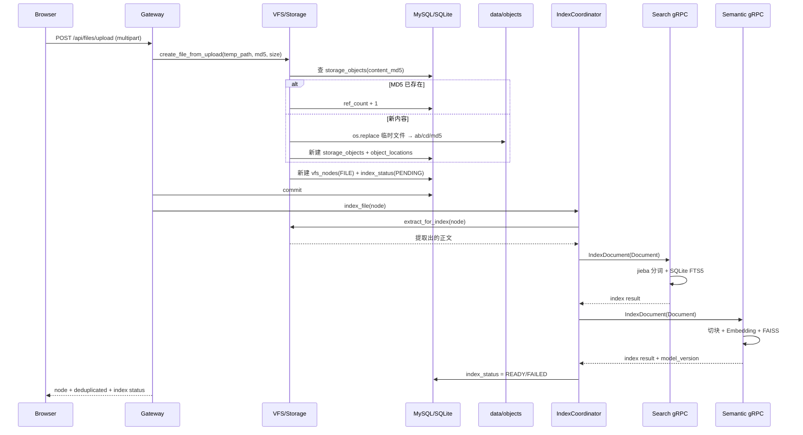
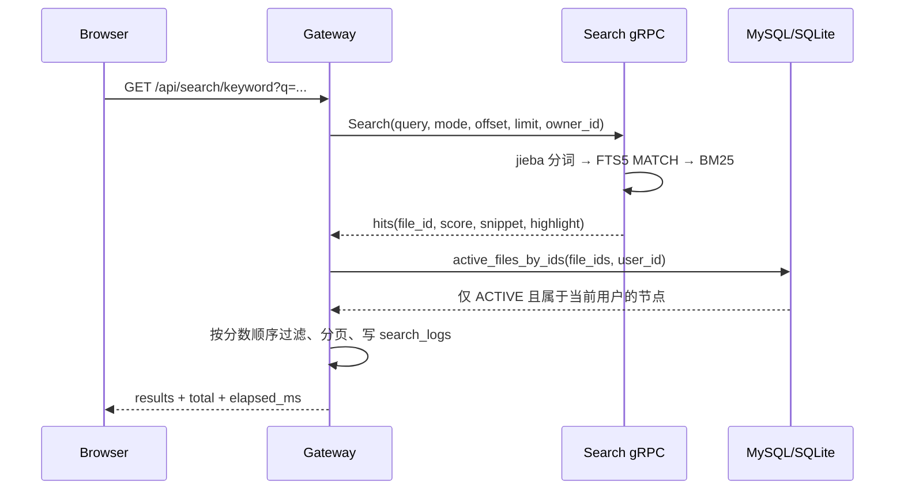
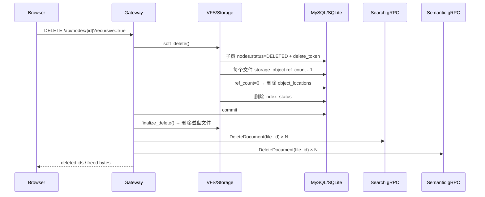

# CloudDisk 代码结构、目录职责与完整调用链

> 本文档面向阅读源码和演示答辩，重点说明：
> 1. 每个目录/每个 Python 文件的职责；
> 2. 三个进程之间的调用关系（尤其是 Gateway → Search / Semantic 的 gRPC 调用）；
> 3. 从注册、上传到搜索、删除的一次完整流程与调用路径。
>
> 具体函数级细节不再逐一罗列，以“模块职责 + 关键调用链”为主。

---

## 1. 系统边界总览

CloudDisk 在运行时是 **三个进程**：

```text
┌──────────────────────────── Browser ────────────────────────────┐
│ HTML / CSS / JS SPA                                              │
└───────────────────────────────┬──────────────────────────────────┘
                                │ HTTP + JWT
                                ▼
┌──────────────────────────────────────────────────────────────────┐
│ Gateway Service（FastAPI + Uvicorn，:8000）                      │
│                                                                  │
│  routers/auth, nodes, files, search, index                       │
│  IndexCoordinator                                                │
│  ┌────────────────────────────────────────────────────────────┐  │
│  │ VFS / Storage Service（同进程，代码模块边界）               │  │
│  │  VFSStorageService + ObjectStorage + text_extract           │  │
│  │  ↓ SQLAlchemy                                              │  │
│  │  SQLite（演示默认）/ MySQL 8（可选）                        │  │
│  │  ↓ 本地文件系统                                             │  │
│  │  data/objects/ab/cd/<md5>                                  │  │
│  └────────────────────────────────────────────────────────────┘  │
└───────────────┬───────────────────────────────┬──────────────────┘
                │ gRPC                          │ gRPC
                ▼                               ▼
┌──────────────────────────────┐  ┌────────────────────────────────┐
│ Search Service（:50051）     │  │ Semantic Service（:50052）     │
│ gRPC + jieba + SQLite FTS5   │  │ gRPC + Embedding + FAISS       │
│ data/search/search_index.db  │  │ data/faiss/                    │
└──────────────────────────────┘  └────────────────────────────────┘
```

### 1.1 谁是“微服务”，谁只是模块

| 组件 | 部署形态 | 通信方式 | 说明 |
|---|---|---|---|
| Gateway | 独立 Uvicorn 进程 | 浏览器 HTTP | 唯一对外入口 |
| VFS / Storage | **与 Gateway 同进程** | 直接 Python 调用 | 需求允许第一版合并，但代码在 `services/vfs_storage/` 中独立 |
| Search | 独立 gRPC 进程 | Gateway ↔ gRPC | 关键词索引与检索 |
| Semantic | 独立 gRPC 进程 | Gateway ↔ gRPC | 向量索引、语义搜索、相似文件 |

**关键点：**

* Search 和 Semantic **不会互相调用**，也不会访问 MySQL。
* 所有业务编排、权限判断、索引状态落库都在 Gateway / VFS 层完成。
* Search / Semantic 只负责“建索引、查索引、返回候选 file_id / 分数 / 摘要”。
* Gateway 拿回候选后，必须再查数据库确认 `owner_id` 和 `status='ACTIVE'`，最终结果才返回给浏览器。

---

## 2. 目录结构

```text
CloudDisk/
├── PROJECT_REQUIREMENTS.md       # 项目需求
├── README.md                     # 启动、配置、验收说明
├── environment.yml               # Conda 环境（DSC5003）
├── environment.lock.yml          # 已验证的精确版本
├── requirements.txt              # pip 依赖视图
├── .env / .env.example           # 本地配置（.env 不提交）
├── protos/
│   └── clouddisk.proto           # gRPC / Protobuf 接口定义
├── clouddisk_grpc/               # protoc 生成的 Python 绑定
├── services/
│   ├── gateway/                  # HTTP 网关、API、索引编排
│   ├── vfs_storage/              # 虚拟文件系统 + MD5 对象存储
│   ├── search/                   # 关键词搜索 gRPC 服务
│   ├── semantic/                 # 语义搜索 gRPC 服务
│   ├── grpc_common.py            # gRPC 公共选项/通道
│   └── proto_utils.py            # 内部文档对象 ↔ Protobuf 转换
├── shared/
│   ├── config/                   # 配置读取
│   ├── db/                       # SQLAlchemy 模型/引擎
│   ├── auth/                     # 密码哈希、JWT
│   ├── documents.py              # 跨服务文档负载
│   ├── service_types.py          # gRPC 客户端结果类型
│   └── errors.py                 # 统一业务异常
├── frontend/                     # 纯 HTML/CSS/JS SPA
├── sql/                          # MySQL DDL、种子、迁移说明
├── alembic/                      # 数据库迁移
├── scripts/                      # 环境/启动/测试数据/索引 CLI
├── tests/                        # pytest 测试
├── docs/                         # ER 图、本文档
└── data/                         # 运行时对象/索引/模型（不提交）
```

### 2.1 运行时数据目录

| 路径 | 内容 |
|---|---|
| `data/objects/ab/cd/<md5>` | MD5 内容寻址的物理文件，相同内容只存一份 |
| `data/tmp/` | 上传临时文件，最终原子移动到 objects |
| `data/search/search_index.db` | SQLite FTS5 关键词索引 |
| `data/faiss/semantic.index` | FAISS 向量索引 |
| `data/faiss/semantic_meta.json` | 语义切片的元数据、模型版本 |
| `data/models/` | sentence-transformers 模型缓存（不提交） |
| `data/clouddisk.db` | 本机 SQLite 演示数据库（生产为 MySQL） |
| `data/logs/` | 预留日志目录 |

---

## 3. 每个 Python 文件的职责

### 3.1 Gateway（对外 HTTP 与编排）

| 文件 | 职责 |
|---|---|
| `services/gateway/app.py` | FastAPI 应用工厂：创建 DB engine/session、VFS、gRPC 客户端、索引编排器、路由、异常处理、前端静态挂载、健康检查 |
| `services/gateway/main.py` | Uvicorn 入口，`app = create_app()`，供 `uvicorn services.gateway.main:app` 使用 |
| `services/gateway/deps.py` | FastAPI 依赖：数据库 Session、Settings、VFS、Search/Semantic 客户端、Coordinator、当前 JWT 用户 |
| `services/gateway/errors.py` | 统一错误响应 `{"error": {"code","message","details"}}`，覆盖业务异常、422 校验、404、500 |
| `services/gateway/schemas.py` | 所有 HTTP 请求/响应 Pydantic 模型（认证、节点、上传、搜索、索引状态等） |
| `services/gateway/coordinator.py` | **索引编排核心**：上传/改名后建索引；删除后删索引；失败重试；关键词/语义索引重建；索引状态汇总 |
| `services/gateway/routers/auth.py` | 注册、登录、`/auth/me`；密码哈希、创建用户根目录、签发 JWT |
| `services/gateway/routers/nodes.py` | 文件夹创建、列表、目录树、路径、重命名、移动、递归软删除 |
| `services/gateway/routers/files.py` | 流式上传、内容替换、下载、文件元数据 |
| `services/gateway/routers/search.py` | 关键词搜索、语义搜索、相似文件；调用 gRPC 后再用 MySQL 过滤；写搜索日志 |
| `services/gateway/routers/index.py` | 索引状态查询、单文件重试、关键词/语义/全部重建（可后台） |
| `services/gateway/routers/__init__.py` | 路由包标记 |
| `services/gateway/__init__.py` | Gateway 包标记 |

### 3.2 VFS / Storage（同进程模块）

| 文件 | 职责 |
|---|---|
| `services/vfs_storage/service.py` | VFS 领域逻辑：节点树、名称校验、移动环检测、上传/替换、引用计数、软删除、级联、索引文本提取、搜索候选的 DB 过滤 |
| `services/vfs_storage/storage.py` | 本地 MD5 对象存储：两级分片路径、原子落盘、去重、删除、路径校验 |
| `services/vfs_storage/text_extract.py` | TXT/HTML/Markdown 正文提取，PDF/DOCX/PPTX/XLSX 可选，编码回退，二进制降级 |
| `services/vfs_storage/__init__.py` | 导出 `VFSStorageService`、`ObjectStorage`、`extract_text` 等 |

### 3.3 Search Service（关键词）

| 文件 | 职责 |
|---|---|
| `services/search/engine.py` | SQLite FTS5 引擎：文档表 + FTS 表、jieba 分词写入、BM25 查询、分页、摘要、启动时修复 FTS、索引持久化 |
| `services/search/tokenizer.py` | jieba 搜索模式/精确模式分词、停用词、FTS 安全清洗 |
| `services/search/snippet.py` | 摘要窗口、HTML 转义、`<mark>` 高亮 |
| `services/search/server.py` | gRPC `SearchService` 实现：IndexDocument/UpdateDocument/DeleteDocument/Search/Health；进程入口 |
| `services/search/client.py` | Gateway 使用的 gRPC 客户端；把 gRPC 异常转换为搜索不可用/校验错误 |
| `services/search/__init__.py` | 惰性导出包接口，避免 `python -m` 重复导入警告 |

### 3.4 Semantic Service（向量）

| 文件 | 职责 |
|---|---|
| `services/semantic/engine.py` | 语义索引：切块、向量矩阵/FAISS、切片元数据、版本校验、tombstone、压缩、搜索、相似文件、重建、持久化 |
| `services/semantic/embedder.py` | 两种 Embedding：sentence-transformers（主）与离线哈希降级；启动时只读缓存，不隐式下载模型 |
| `services/semantic/chunking.py` | 按句子边界切块，控制 chunk size / overlap / max chunks |
| `services/semantic/server.py` | gRPC `SemanticService` 实现：IndexDocument/DeleteDocument/SemanticSearch/SimilarFiles/RebuildIndex/Health；进程入口 |
| `services/semantic/client.py` | Gateway 使用的语义 gRPC 客户端；异常转换 |
| `services/semantic/__init__.py` | 惰性导出包接口 |

### 3.5 跨服务公共代码

| 文件 | 职责 |
|---|---|
| `services/__init__.py` | services 包标记 |
| `services/grpc_common.py` | gRPC channel 创建、消息大小/keepalive 参数 |
| `services/proto_utils.py` | `IndexDocumentPayload` ↔ `clouddisk_pb2.Document` 转换 |
| `shared/documents.py` | 跨服务统一的文档负载；`semantic_text` 拼接标题/描述/正文；从 VFS 节点构造 |
| `shared/service_types.py` | gRPC 客户端结果类型：SearchHit/SearchPage/SemanticHit/IndexResult/ServiceHealth 等 |
| `shared/errors.py` | 业务异常与 HTTP 状态、错误码（含搜索/语义不可用、存储完整性等） |

### 3.6 共享基础设施

| 文件 | 职责 |
|---|---|
| `shared/config/settings.py` | 从环境变量/.env 读取全部配置；路径、端口、上传限制、语义阈值等 |
| `shared/db/models.py` | SQLAlchemy 2.x 模型：users、vfs_nodes、storage_objects、storage_nodes、object_locations、file_permissions、share_links、index_status、search_logs |
| `shared/db/session.py` | MySQL/SQLite engine、session factory、SQLite 外键 PRAGMA、`init_db` |
| `shared/auth/passwords.py` | bcrypt + SHA-256 预哈希；无 bcrypt 时 PBKDF2 回退 |
| `shared/auth/jwt_tokens.py` | JWT 签发与校验 |
| `shared/auth/__init__.py` | 认证函数导出 |
| `shared/config/__init__.py` / `shared/db/__init__.py` | 包导出 |
| `shared/__init__.py` | 版本号 |

### 3.7 生成代码与数据库脚本

| 文件 | 职责 |
|---|---|
| `clouddisk_grpc/clouddisk_pb2.py` | protoc 生成的 Protobuf 消息类 |
| `clouddisk_grpc/clouddisk_pb2_grpc.py` | 生成的服务 Stub/Servicer/注册函数 |
| `clouddisk_grpc/__init__.py` | 生成包标记 |
| `sql/schema.sql` | MySQL 8 生产 DDL（核心事实源） |
| `sql/create_database.sql` | 创建数据库与账号 |
| `sql/seed.py` | 建表并创建演示用户/根目录 |
| `sql/legacy_disk.sql` | 旧原型 `disk.sql` |
| `sql/MIGRATION.md` | 旧表到新表的映射 |
| `alembic/env.py` | Alembic 读取同一 Settings/DATABASE_URL |
| `alembic/versions/0001_initial_schema.py` | 初始迁移（按 SQLAlchemy metadata 建表） |

### 3.8 脚本

| 文件 | 职责 |
|---|---|
| `scripts/run_services.py` | 一次启动 Search、Semantic、Gateway 三个子进程，等待端口，处理 Ctrl+C |
| `scripts/setup_conda_env.sh` | 安装/定位 Miniforge，创建 `DSC5003`，验证依赖（shell） |
| `scripts/generate_protos.sh` | 重新生成 `clouddisk_grpc/`（shell） |
| `scripts/generate_test_data.py` | 通过真实 HTTP API 创建中文示例文档，演示 MD5 去重 |
| `scripts/rebuild_indexes.py` | 通过 HTTP API 重试失败索引/重建关键词/语义索引 |
| `scripts/download_semantic_model.py` | 显式下载 sentence-transformers 模型并预热缓存 |

### 3.9 测试

| 文件 | 职责 |
|---|---|
| `tests/conftest.py` | 启动真实 Search/Semantic gRPC 服务（临时端口）、创建 SQLite 测试库、TestClient |
| `tests/utils.py` | 注册用户、上传、搜索、下载等测试辅助 |
| `tests/test_auth.py` | 注册/登录/JWT/用户隔离 |
| `tests/test_vfs.py` | 文件夹、树、路径、改名、移动环、软删除、根目录保护 |
| `tests/test_storage.py` | MD5 去重、引用计数、物理清理、内容更新、空文件 |
| `tests/test_search.py` | 中文关键词、文件名/正文模式、短语、分页、HTML/Markdown、删除过滤、日志 |
| `tests/test_semantic.py` | 语义排名、相似文件、删除、降级标记 |
| `tests/test_index.py` | 索引状态、改名重索引、失败重试、关键词/语义重建、内容更新 |
| `tests/test_db_constraints.py` | 唯一约束、CHECK、外键、负引用、索引状态枚举等 |
| `tests/test_degradation.py` | 语义关闭、搜索宕机、FAISS/FTS 损坏恢复 |
| `tests/test_text_extract.py` | HTML 脚本过滤、Markdown、GB18030、截断、二进制 |
| `tests/test_e2e.py` | 静态页面 + 完整用户旅程 |
| `tests/__init__.py` | 测试包标记 |

### 3.10 前端与配置文件

| 文件 | 职责 |
|---|---|
| `frontend/index.html` | 登录、文件管理、搜索、索引弹窗的页面结构 |
| `frontend/app.js` | 所有页面行为；只调用真实 `/api` 接口；上传进度、搜索分页、索引重试/重建 |
| `frontend/styles.css` | 页面样式与响应式布局 |
| `protos/clouddisk.proto` | Search/Semantic 的 RPC 与消息定义 |
| `docs/ER.md` | 数据库 ER 图 |
| `pytest.ini` / `alembic.ini` / `.condarc` | 测试、迁移、conda 镜像配置 |

---

## 4. 微服务之间的调用契约

### 4.1 唯一的跨进程调用方向

```text
Browser ──HTTP──▶ Gateway ──gRPC──▶ Search
                         └─gRPC──▶ Semantic
```

没有以下调用：

* Search → Gateway
* Semantic → Gateway
* Search ↔ Semantic
* Search/Semantic → MySQL
* 浏览器 → Search/Semantic

### 4.2 SearchService（`clouddisk.proto`）

| RPC | 调用者/时机 | 作用 |
|---|---|---|
| `IndexDocument` | Gateway 上传、改名、重试、关键词重建 | 写入/覆盖一条文档索引 |
| `UpdateDocument` | 预留（Gateway 通常直接用 IndexDocument 覆盖） | 更新索引 |
| `DeleteDocument` | Gateway 软删除、重建前清理 | 删除指定 file_id 的索引 |
| `Search` | Gateway 关键词搜索 | 返回候选 file_id、分数、摘要、高亮 |
| `Health` | Gateway 索引状态/健康检查 | 服务健康、文档数、引擎信息 |

### 4.3 SemanticService

| RPC | 调用者/时机 | 作用 |
|---|---|---|
| `IndexDocument` | Gateway 上传、改名、重试 | 切块、编码、写入 FAISS |
| `DeleteDocument` | Gateway 软删除、重建前清理 | 标记/删除指定 file_id 的向量 |
| `SemanticSearch` | Gateway 语义搜索 | 返回候选 file_id、余弦分数、片段 |
| `SimilarFiles` | Gateway 相似文件 | 用目标文件平均向量检索其它文件 |
| `RebuildIndex` | Gateway 语义重建 | 按传入文档重建/追加索引 |
| `Health` | Gateway 状态/健康检查 | 模型版本、引擎、向量数 |

### 4.4 公共文档负载

Gateway 不把 ORM 对象直接发给 gRPC，而是先构造 `shared.documents.IndexDocumentPayload`：

```text
VFSNode + 提取正文
      ↓
IndexDocumentPayload(file_id, title, content, owner_id, mime_type, updated_at, version, description)
      ↓ services/proto_utils.py
clouddisk_pb2.Document
      ↓
SearchEngine / SemanticEngine
```

`file_id` **始终是 VFS 的 `node_id` 字符串**，不是 MD5，也不是物理对象 ID。

### 4.5 超时与降级

* 搜索查询默认 5 秒；索引默认 30 秒；健康检查默认 2 秒（见 `.env`）。
* gRPC 不可达/超时 → Gateway 返回 `503 SEARCH_UNAVAILABLE` 或 `SEMANTIC_UNAVAILABLE`。
* 上传时索引失败不会回滚文件：文件已保存，`index_status` 记为 `FAILED`，可重试。
* 语义服务不可用不影响关键词；搜索服务不可用不影响文件管理。

---

## 5. 启动流程与调用路径

### 5.1 三条进程如何启动

```text
python scripts/run_services.py
│
├─ 子进程 1: python -m services.search.server
│    └─ SearchEngine(data/search/search_index.db)
│       SearchGrpcServer.start() → 0.0.0.0/127.0.0.1:50051
│
├─ 子进程 2: python -m services.semantic.server
│    └─ build_embedder()
│         有缓存模型 → sentence-transformers
│         无缓存/不可用 → 离线哈希（degraded）
│       SemanticEngine(data/faiss/...)
│       SemanticGrpcServer.start() → :50052
│
└─ 子进程 3: python -m uvicorn services.gateway.main:app
     └─ services/gateway/main.py: app = create_app()
        └─ services/gateway/app.py: create_app()
           ├─ Settings.from_env() / ensure_directories()
           ├─ make_engine(DATABASE_URL) → init_db()
           ├─ VFSStorageService(settings)
           ├─ SearchClient(host, port) / SemanticClient(host, port)
           ├─ IndexCoordinator(settings, vfs, search_client, semantic_client)
           ├─ 注册 /api 路由、异常处理、CORS
           ├─ 挂载 frontend/
           └─ 启动 Uvicorn :8000
```

`run_services.py` 会等待 Search/Semantic 端口就绪，再启动 Gateway；Gateway 的 gRPC 客户端是**懒连接**，第一次实际调用时才创建 channel。

### 5.2 启动时的服务依赖

```text
Gateway 启动 → 只依赖数据库可用
              （Search/Semantic 未启动也能启动 Gateway）
第一次上传/搜索 → 才连接对应 gRPC 服务
```

因此演示时可以单独启动 Gateway 做文件管理，搜索/语义稍后启动。

---

## 6. 完整业务流程图与调用链

下面按用户实际操作顺序说明。

### 6.1 注册 / 登录

```text
frontend/app.js
  └─ POST /api/auth/register 或 /auth/login
       └─ services/gateway/routers/auth.py
          ├─ shared/auth/passwords.py: hash_password / verify_password
          ├─ shared/auth/jwt_tokens.py: create_access_token
          ├─ User 写入 users
          ├─ VFSStorageService.create_root() → 创建“我的文件”根节点
          └─ 返回 access_token + UserOut
```

* 注册时自动为每个用户创建根目录，后续 `parent_id=None` 统一解析到根目录。
* 登录后所有 API 都带 `Authorization: Bearer <JWT>`。

### 6.2 创建文件夹

```text
frontend → POST /api/folders
  → services/gateway/routers/nodes.py: create_folder
    → VFSStorageService.resolve_parent / create_folder
      → vfs_nodes 插入（type=FOLDER）
```

没有跨服务调用，纯 Gateway + 数据库操作。

### 6.3 上传文件（最核心的跨服务链路）



具体文件调用路径：

```text
frontend/app.js: uploadOne()
  → POST /api/files/upload
    → services/gateway/routers/files.py: upload_file()
      → _stream_upload()                 # 临时文件 + MD5 + size
      → VFSStorageService.create_file_from_upload()
         → _assert_name_free()
         → _link_storage_object()
            → ObjectStorage.persist_temp()
            → storage_objects.ref_count / object_locations
         → vfs_nodes + index_status
      → db.commit()
      → IndexCoordinator.index_file()
         → VFSStorageService.extract_for_index()
            → text_extract.extract_text()
         → IndexDocumentPayload.from_node()
         → SearchClient.index_document()
            → gRPC SearchService/IndexDocument
               → SearchEngine.index_document()
                  → jieba 分词 → documents + documents_fts
         → SemanticClient.index_document()
            → gRPC SemanticService/IndexDocument
               → SemanticEngine.index_document()
                  → chunk_text() → embedder.encode() → FAISS
         → index_status 更新 + commit
```

关键业务规则：

* **上传成功 ≠ 索引成功**：文件先落库，索引失败只写 `FAILED`，可重试。
* **相同 MD5 不重复写盘**：只增加引用计数。
* **物理对象在最后一个引用删除后清理**。
* 索引状态同时记录关键词/语义状态、版本、错误、重试次数。

### 6.4 下载文件

```text
frontend/app.js: downloadFile()
  → GET /api/files/{id}/download
    → files.py: download_file()
      → VFSStorageService.get_download_info()
         → vfs_nodes + content_md5
         → ObjectStorage.absolute_path(md5)
      → FileResponse(流式, Content-Disposition, X-Content-MD5)
```

* 只查数据库和本地文件系统，**不经过 Search/Semantic**。
* 权限在 Gateway/VFS 层校验（当前为所有者访问）。

### 6.5 关键词搜索（Gateway → Search → Gateway）



调用路径：

```text
frontend/app.js: runKeywordSearch()
  → GET /api/search/keyword
    → services/gateway/routers/search.py: keyword_search()
      → SearchClient.search()
         → gRPC SearchService/Search
            → SearchEngine.search()
               → _build_match_query() → FTS5 MATCH + bm25()
               → make_snippet() / highlight_html()
      → VFSStorageService.active_files_by_ids()
         → 过滤 owner_id + ACTIVE + FILE
      → 分页
      → _log_search() → search_logs
```

**重要：** Search 服务只返回候选；真正的权限与删除过滤是 Gateway 查数据库完成的。

### 6.6 语义搜索（Gateway → Semantic → Gateway）

```text
frontend/app.js: runSemanticSearch()
  → GET /api/search/semantic
    → services/gateway/routers/search.py: semantic_search()
      → SemanticClient.search()
         → gRPC SemanticService/SemanticSearch
            → SemanticEngine.search()
               → embedder.encode(query)
               → FAISS / numpy 内积检索
               → 跳过 tombstone / 低分 / 其他 owner
      → VFSStorageService.active_files_by_ids()   # 再次 DB 过滤
      → search_logs
      → 返回结果 + degraded + model_version
```

* 语义索引是**全局共享**的，不按用户分库；owner 过滤在 Semantic 和 Gateway 两层都有。
* `degraded=true` 表示当前使用离线哈希 Embedding，不是真正的神经语义模型。
* 修改模型后需要重建语义索引（模型版本不匹配会拒绝加载旧索引）。

### 6.7 相似文件

```text
frontend: 文件行“相似” / 搜索结果“相似文件”
  → GET /api/files/{id}/similar
    → VFSStorageService.get_file_node()       # 先确认文件属于当前用户
    → SemanticClient.similar()
       → gRPC SemanticService/SimilarFiles
          → SemanticEngine.similar()
             → 目标文件所有切片向量求均值
             → FAISS 检索
             → 排除自身、低于阈值
    → active_files_by_ids()                   # 最终 DB 过滤
    → 返回相似文件列表
```

### 6.8 重命名 / 移动

```text
PATCH /api/nodes/{id}
  → nodes.py: update_node()
    ├─ name 改变 → VFSStorageService.rename_node()（只改 vfs_nodes.name）
    │              → db.commit()
    │              → IndexCoordinator.index_file()
    │                 → Search gRPC IndexDocument（更新标题）
    │                 → Semantic gRPC IndexDocument（标题/正文重新向量化）
    └─ parent_id 改变 → VFSStorageService.move_node()（只改 parent_id）
                       → 不需要重建索引
```

* 重命名不改变物理 MD5 文件。
* 移动只改父节点，搜索索引中的 file_id 和内容不变。

### 6.9 替换文件内容

```text
PUT /api/files/{id}/content
  → files.py: replace_content()
    → _stream_upload()                          # 新 MD5 / size
    → VFSStorageService.replace_file_content()
       ├─ 新 MD5 已存在 → 复用 storage_object，ref_count +1
       ├─ 新 MD5 不存在 → 新增 storage_object + 落盘
       ├─ vfs_nodes 指向新对象，version + 1
       ├─ 旧对象 ref_count -1；为 0 时标记清理
       └─ index_status 重置 PENDING
    → db.commit()
    → 删除旧物理文件（如无其他引用）
    → IndexCoordinator.index_file()             # 重新走关键词 + 语义索引
```

### 6.10 删除文件 / 文件夹（跨服务删除索引）



* 软删除：VFS 节点保留，状态置 `DELETED`，因此同名文件可以重新创建。
* 物理文件只在引用计数归零时清理。
* 索引删除是“尽力而为”；即使索引删除失败，Gateway 的 DB 过滤也不会返回已删除文件。
* `storage_objects` 行在 ref_count=0 时保留为内容元数据（软删除节点仍通过外键引用它），再上传相同内容时可复用并重新落盘。

### 6.11 索引状态 / 重试 / 重建

**状态查询：**

```text
GET /api/index/status
  → coordinator.summary()                     # 聚合 index_status
  → SearchClient.health() → gRPC Health
  → SemanticClient.health() → gRPC Health
  → 返回文件计数 + 两个服务健康
```

**单文件重试：**

```text
POST /api/index/{file_id}/retry
  → coordinator.retry_file()
    → VFS 确认文件属于当前用户
    → index_file() → Search gRPC IndexDocument + Semantic gRPC IndexDocument
    → 更新 index_status
```

**关键词重建：**

```text
POST /api/index/rebuild {"kinds":"keyword"}
  → coordinator.rebuild()
    → 读取当前用户全部 ACTIVE 文件 + 提取正文
    → 对用户所有历史 file_id 调 Search.DeleteDocument（清陈旧项）
    → 逐文件 Search.IndexDocument
    → 更新 index_status
```

**语义重建：**

```text
POST /api/index/rebuild {"kinds":"semantic"}
  → coordinator.rebuild()
    → 对用户所有历史 file_id 调 Semantic.DeleteDocument
    → Semantic.RebuildIndex(documents=当前文件, clear=false)
    → 更新 index_status
```

* 重建只清理**当前用户**的索引项，不会清空其他用户的共享索引。
* 可选 `background=true`，由 BackgroundTasks 在独立 DB session 中执行。

### 6.12 降级流程

| 情况 | 调用变化 | 结果 |
|---|---|---|
| Search 未启动 | Gateway → Search 的 gRPC 连接失败/超时 | 关键词搜索 503；上传文件仍成功，keyword 索引 FAILED；文件管理正常 |
| Semantic 未启动 | Gateway → Semantic 的 gRPC 连接失败 | 语义搜索/相似文件 503；关键词可用；上传仍成功，semantic FAILED |
| 语义无模型缓存 | `build_embedder()` 直接选择哈希 Embedding | 语义服务启动；`degraded=true`；前端提示 |
| 索引失败 | `index_status.last_error` 记录 | 可在前端单文件重试或全量重建 |
| FAISS 文件损坏 | 启动时从 `.npy` 向量副本重建 | 仍可搜索 |
| FTS 行数不一致 | `SearchEngine._repair_fts_if_needed()` | 从 documents 重建 FTS |

`IndexCoordinator` 有 10 秒的短负缓存，避免服务宕机时每次上传都等满超时。

---

## 7. 一次完整的用户旅程（端到端）

```text
1. 启动
   scripts/run_services.py
     → Search :50051 + Semantic :50052 + Gateway :8000

2. 注册 / 登录
   Browser → /api/auth/register/login
     → users + 根目录 vfs_nodes
     → JWT

3. 创建文件夹
   Browser → POST /api/folders
     → vfs_nodes(FOLDER)

4. 上传文件
   Browser → POST /api/files/upload
     → data/objects/ab/cd/<md5>
     → storage_objects + vfs_nodes(FILE) + index_status
     → IndexCoordinator
        → Search gRPC IndexDocument → SQLite FTS5
        → Semantic gRPC IndexDocument → Embedding → FAISS
     → 返回 node + READY/FAILED

5. 浏览文件
   Browser → GET /api/nodes?parent_id=...
     → vfs_nodes 列表（不经过 Search/Semantic）

6. 下载
   Browser → GET /api/files/{id}/download
     → vfs_nodes + data/objects/<md5>
     → FileResponse

7. 关键词搜索
   Browser → GET /api/search/keyword
     → Search gRPC Search → FTS5 + BM25
     → Gateway 查 vfs_nodes 过滤 owner/ACTIVE
     → 摘要/高亮/分页 + search_logs

8. 语义搜索
   Browser → GET /api/search/semantic
     → Semantic gRPC SemanticSearch → FAISS
     → Gateway DB 过滤
     → 返回分数/片段/degraded

9. 相似文件
   Browser → GET /api/files/{id}/similar
     → Semantic gRPC SimilarFiles → FAISS
     → Gateway DB 过滤

10. 重命名 / 移动
    PATCH /api/nodes/{id}
      → 改名：vfs_nodes.name + 两个索引重建
      → 移动：vfs_nodes.parent_id（不重建索引）

11. 索引异常
    GET /api/index/status → 查看 FAILED / last_error
    POST /api/index/{id}/retry → 单文件重试
    POST /api/index/rebuild → 关键词/语义/全部重建

12. 删除
    DELETE /api/nodes/{id}
      → 软删除 + 引用计数 + 物理清理
      → Search/Semantic DeleteDocument
      → 后续搜索由 DB 过滤保证不再出现
```

---

## 8. 关键一致性规则

1. **file_id = VFS node_id**：所有索引、搜索、相似文件都使用逻辑节点 ID。
2. **物理内容与逻辑文件分离**：`vfs_nodes` 只存元数据和 `storage_object_id`，磁盘文件按 MD5 命名。
3. **MD5 唯一 + 引用计数**：相同内容只存一份；最后一个引用删除才清理物理文件。
4. **搜索服务不掌握权限**：最终结果必须由 Gateway/VFS 查询 `vfs_nodes` 过滤。
5. **索引状态以 MySQL/SQLite 的 `index_status` 为准**；Search/Semantic 的内部状态只是索引实现细节。
6. **上传先落库、后索引**：索引失败可重试，不影响文件实体。
7. **重建按用户清理**：正常用户重建不会清空其他用户的共享索引。
8. **删除后立即不可搜**：即使索引删除失败，DB 过滤也会排除 `status='DELETED'`。

---

## 9. 配置与端口速查

| 项 | 默认/当前 | 说明 |
|---|---|---|
| Gateway | `127.0.0.1:8000`（本机）/ `0.0.0.0:8000`（服务器直连） | 对外 HTTP + 前端 |
| Search gRPC | `127.0.0.1:50051` | 仅内网/本机 |
| Semantic gRPC | `127.0.0.1:50052` | 仅内网/本机 |
| `DATABASE_URL` | 演示默认 SQLite；可选 MySQL 8 | 主数据库 |
| `SEARCH_INDEX_PATH` | `data/search/search_index.db` | FTS5 |
| `SEMANTIC_INDEX_PATH` | `data/faiss/semantic.index` | FAISS |
| `SEMANTIC_EMBEDDER` | `auto` | 有缓存模型用 ST，否则离线哈希 |
| `SEARCH_TIMEOUT_SECONDS` | 5 | 搜索 RPC 超时 |
| `INDEX_TIMEOUT_SECONDS` | 30 | 索引 RPC 超时 |
| `HEALTH_TIMEOUT_SECONDS` | 2 | 健康检查超时 |

---

## 10. 扩展点

| 想增加的功能 | 应该改哪里 |
|---|---|
| 文件权限/分享 | `file_permissions` / `share_links` 表已有；扩展 `VFSStorageService.get_node` / `active_files_by_ids`；Gateway 过滤层 |
| 新增文件格式提取 | `services/vfs_storage/text_extract.py` |
| 更换 Embedding 模型 | `.env` 的 `SEMANTIC_MODEL_NAME`；`services/semantic/embedder.py`；重建语义索引 |
| 更换关键词排序 | `services/search/engine.py` 的 BM25 权重/查询构造 |
| 增加搜索字段（标签等） | `Document` 协议字段、`SearchEngine` FTS 表、Gateway 文档构造 |
| 多存储节点 | `storage_nodes` / `object_locations` 已建模；扩展 `ObjectStorage` 和 `_ensure_object_location` |
| 把 VFS 拆成独立服务 | 将 `services/vfs_storage` 暴露为 gRPC，Gateway 的 `deps.get_vfs` 改为客户端 |
| 增加 Redis 缓存 | Gateway 搜索/元数据层；不改变 Search/Semantic 契约 |
