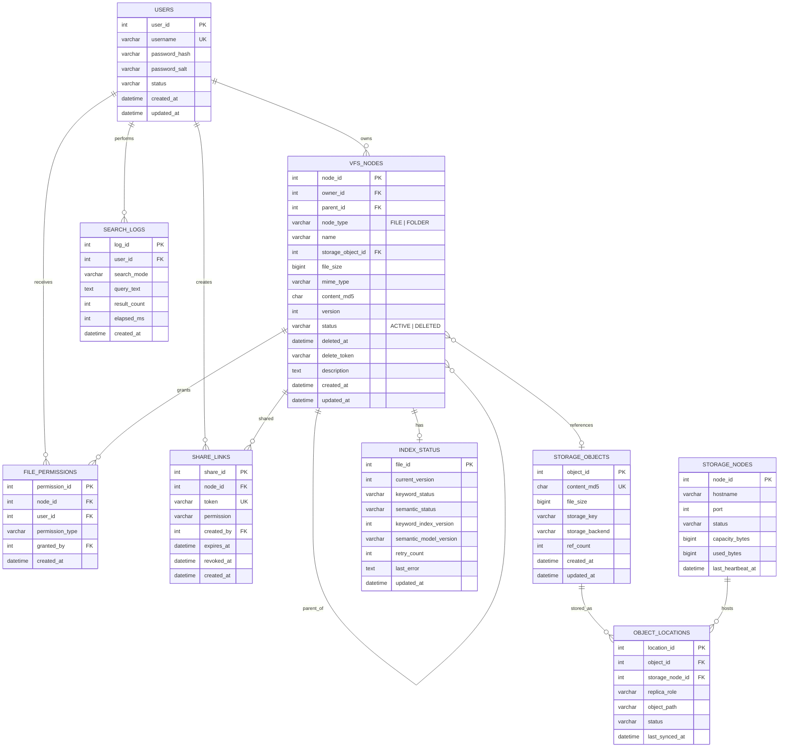

# CloudDisk 数据库 ER 图

> 与 `sql/schema.sql` 和 `shared/db/models.py` 一一对应。

## 关键约束

| 约束 | 实现 |
|---|---|
| 用户名唯一 | `UNIQUE(users.username)`，应用层大小写不敏感检查 |
| MD5 存储对象唯一 | `UNIQUE(storage_objects.content_md5)` |
| 同一文件夹活动名唯一 | `UNIQUE(owner_id, parent_id, name, delete_token)`，活动节点 `delete_token='0'` |
| 文件必须有存储对象 | CHECK: `FILE` ⇔ `storage_object_id IS NOT NULL` |
| 文件夹不能有存储对象 | 同上 CHECK 的反向条件 |
| 引用计数非负 | `CHECK(ref_count >= 0)` |
| 大小非负 | `CHECK(file_size >= 0)` |
| 索引状态有限值 | `CHECK(status IN ('PENDING','INDEXING','READY','FAILED'))` |
| 搜索结果过滤 | Gateway 用 `vfs_nodes.owner_id + status='ACTIVE'` 二次查询 |
